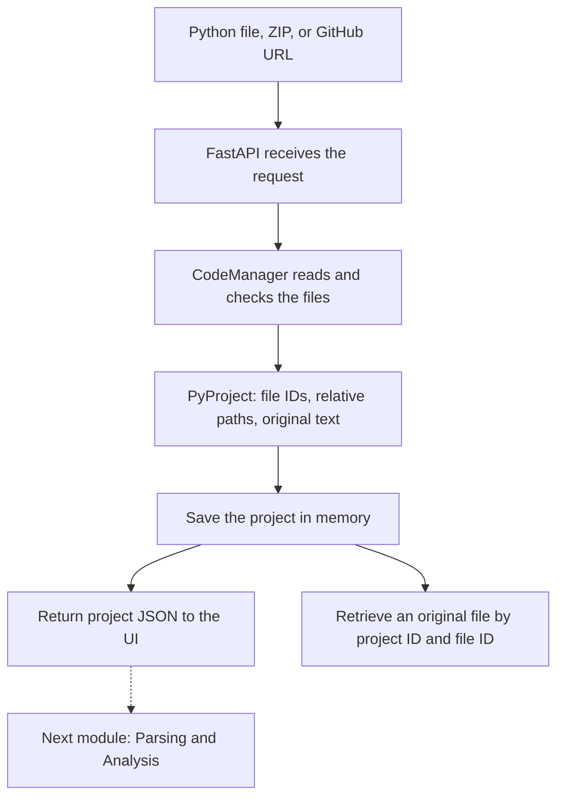

# FlowBridge Code Manager

Code Manager accepts a Python file, ZIP, or public GitHub repository. It collects
the Python files into one project, keeps their original source and folder paths,
and makes those files available to the parser and source-code view.

The repository is now named [FlowBridge](https://github.com/jerphan/FlowBridge).
This backend is on `codex/code-manager` in [PR #1](https://github.com/jerphan/FlowBridge/pull/1).
The team's newer React/Vite frontend is on `main`; the backend PR still needs to
be merged and the UI connected to its routes.

## Start with three files

| File | What to look for |
| --- | --- |
| [flowbridge/service.py](flowbridge/service.py) | `CodeManager`: import a file, ZIP, or GitHub repository, then retrieve the project or an original file. |
| [flowbridge/models.py](flowbridge/models.py) | `SourceFile` stores one file's ID, name, path, and text; `PyProject` groups the files. |
| [flowbridge/api.py](flowbridge/api.py) | FastAPI routes that let the UI call the module. |

The root [CodeManager.py](CodeManager.py) only keeps the original import names
working. The implementation is inside `flowbridge/`.

## How the module works



All three inputs produce the same project format. Failed imports leave earlier
projects available. The dotted arrow is future integration: Code Manager reads
source as text; Harsha's parser will analyze it and build the graph data.

## Why the other files exist

`readers.py` and `paths.py` handle source text, ZIP entries, and relative paths.
`github.py` downloads repository ZIPs for that same reader. `registry.py` keeps
successful projects available between requests, until the server stops.
`config.py` and `errors.py` hold limits and shared error messages; `cli.py` runs
the terminal demo.

`tests/` checks behavior, `examples/` supplies a small nested project, and `docs/`
contains the detailed handoff. `pyproject.toml` lists Python dependencies;
`uv.lock` records their versions and is generated by uv.

## Run the backend

Use Python 3.12 and [uv](https://docs.astral.sh/uv/getting-started/installation/).
From this branch's repository root:

```powershell
uv sync --locked
uv run uvicorn flowbridge.api:app --host 127.0.0.1 --port 8000
```

Open <http://127.0.0.1:8000/docs> to try file, ZIP, and GitHub imports. The demo
stores projects in memory, so use one server worker and expect a restart to clear
them. Public GitHub imports work without a token.

## Test or try one file

```powershell
uv run pytest -q --cov=flowbridge --cov-report=term-missing
uv run flowbridge-code file examples/sample_project/app/main.py
```

The terminal demo prints the same project JSON returned by the API.

## HTTP contract

The response contains `projectID`, `projectName`, and `files`. Each file contains
`fileID`, `fileName`, `filePath`, and `fileContent`. Keep those names and IDs when
passing the project to another module.

See the [route table and sample JSON](docs/CODE_MANAGER_HANDOFF.md#http-contract)
for integration details.

## More detail when needed

- [Full team handoff: setup, methods, JSON, limits, and integration](docs/CODE_MANAGER_HANDOFF.md)
- [Test evidence and user-validation checklist](docs/VALIDATION.md)
- [Three slides of module talking points](docs/POWERPOINT_BULLETS.md)
- [Class diagram](docs/diagrams/code-manager-class.mmd), [upload sequence](docs/diagrams/upload-sequence.mmd), and [GitHub sequence](docs/diagrams/github-sequence.mmd)
