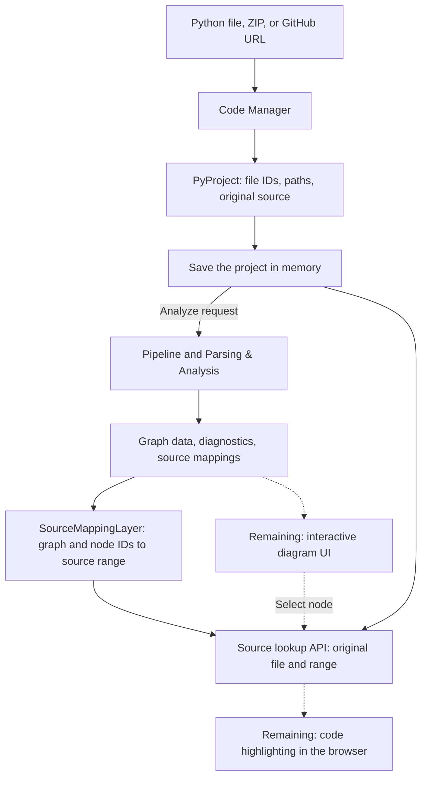

# FlowBridge

FlowBridge turns Python source into interactive diagrams. Code Manager and
Parsing & Analysis are connected through a working backend pipeline. Source Mapping
resolves graph nodes to original files and source ranges. The React interface still
needs to display the returned graphs and highlights.

## Module status

| Module | Current state |
| --- | --- |
| Code Manager | Python, ZIP, and public GitHub imports; project storage and original-source retrieval. |
| Parsing & Analysis | Connected to Code Manager; produces graph data, diagnostics, and source mappings for its [supported Python subset](FlowBridge_ParsingAndAnalysis/docs/PARSING_FEATURES.md). |
| Diagram Manager | Graph data is available; layout, interactive rendering, view navigation, and export remain. |
| Source Mapping / Connection Management | Backend lookup and original-file response implemented; browser node selection and code highlighting remain. |
| User Interface | File/ZIP upload requests and a file-view component exist; GitHub input, Start/analyze, graph display, and highlights still need connecting. |

## Where to start

- [FlowBridgeBackend/service.py](FlowBridgeBackend/service.py): Code Manager imports and file lookups.
- [FlowBridgeBackend/models.py](FlowBridgeBackend/models.py): shared project and source-file fields.
- [FlowBridgeBackend/api.py](FlowBridgeBackend/api.py): upload, lookup, and analysis routes.
- [FlowBridgeBackend/pipeline.py](FlowBridgeBackend/pipeline.py): passes the project to Harsha's parser.
- [FlowBridgeBackend/source_mapping.py](FlowBridgeBackend/source_mapping.py): Grace's graph/node source lookups.
- [FlowBridge_ParsingAndAnalysis](FlowBridge_ParsingAndAnalysis): parser implementation and its integration guide.
- [FlowBridgeFrontend](FlowBridgeFrontend): the team's React interface.

The implementation lives in `FlowBridgeBackend/`. `CodeManager.py` and the small
`flowbridge/` package preserve the original imports; they use the same backend
classes rather than maintaining another implementation.

## How the modules fit together



Solid arrows are implemented backend behavior. Dotted arrows are remaining UI
integration. The parser reads source as text and never runs uploaded code.

## Install and run

Use Python 3.12 and [uv](https://docs.astral.sh/uv/getting-started/installation/).
Run from the repository root:

```powershell
uv sync --locked
uv run uvicorn FlowBridgeBackend.api:app --host 127.0.0.1 --port 8000
```

Open <http://127.0.0.1:8000/docs>. Import a file, ZIP, or public repository, copy
its `projectID`, then call `POST /api/projects/{projectID}/analyze`. The response
contains the full analysis, `flowchart`, and `mapping`.

The demo stores projects in memory. Use one server worker; restarting clears
them. Public GitHub imports work without a token.

## Verify or demonstrate

```powershell
uv run python scripts/check_modules.py
uv run python scripts/run_pipeline.py file examples/sample_project/app/main.py --output-dir examples/pipeline_results
```

The check command runs the Code Manager/integration tests and Harsha's separate
parser suite from their expected working directories. The demo saves matching
analysis, flowchart, and mapping JSON. Relative and absolute output folders work.

GitHub's **Backend checks** workflow runs both suites, checks backend lint,
builds the package, and verifies the installed wheel outside the source checkout.

## HTTP contract

Imports return `projectID`, `projectName`, and `files`. Each file contains
`fileID`, `fileName`, `filePath`, and `fileContent`. The analysis adapter maps
the ID spelling to the parser's `projectId` and `fileId` without changing their values.

Analysis routes accept a nonnegative `revisionId` query parameter, defaulting to 1
for an imported snapshot. Keep flowchart and mapping results from the same project
and revision. A future editing coordinator must assign a new revision for changed text.

Resolve a source-backed node with
`GET /api/projects/{projectID}/source-location?graphId=...&nodeId=...&revisionId=1`.
It returns `projectId`, `revisionId`, `location`, and the original `file` object.
Use the graph/node IDs and revision from the same analysis response. Nodes without
source locations, including synthetic Start/End nodes, return HTTP 404.

See the [route table and sample JSON](docs/CODE_MANAGER_HANDOFF.md#http-contract).

## Team references

- [Code Manager and backend handoff](docs/CODE_MANAGER_HANDOFF.md)
- [Parser integration and consumer contracts](FlowBridge_ParsingAndAnalysis/docs/INTEGRATION_GUIDE.md)
- [Verification evidence and user-validation checklist](docs/VALIDATION.md)
- [Three slides of Code Manager talking points](docs/POWERPOINT_BULLETS.md)
- [Class diagram](docs/diagrams/code-manager-class.mmd), [upload sequence](docs/diagrams/upload-sequence.mmd), and [GitHub sequence](docs/diagrams/github-sequence.mmd)
